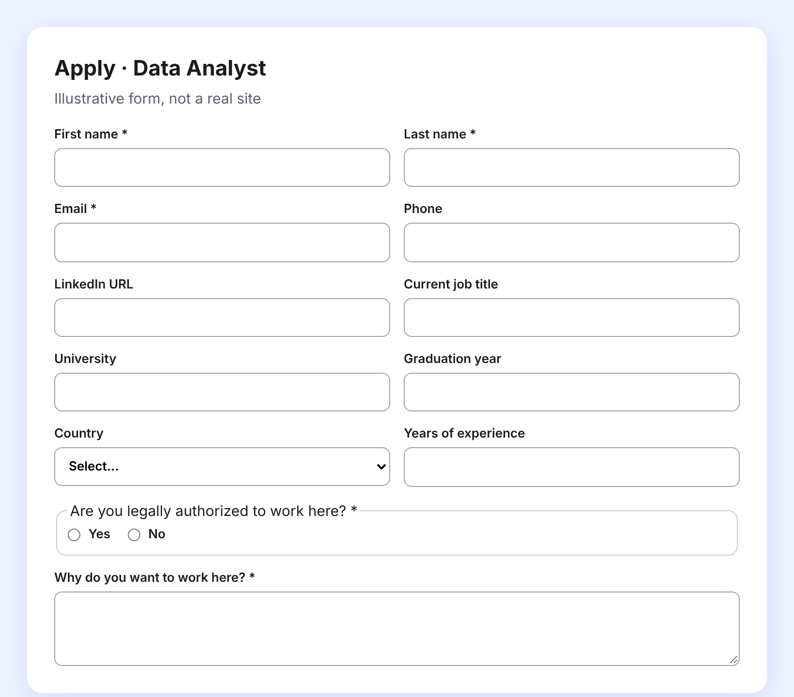
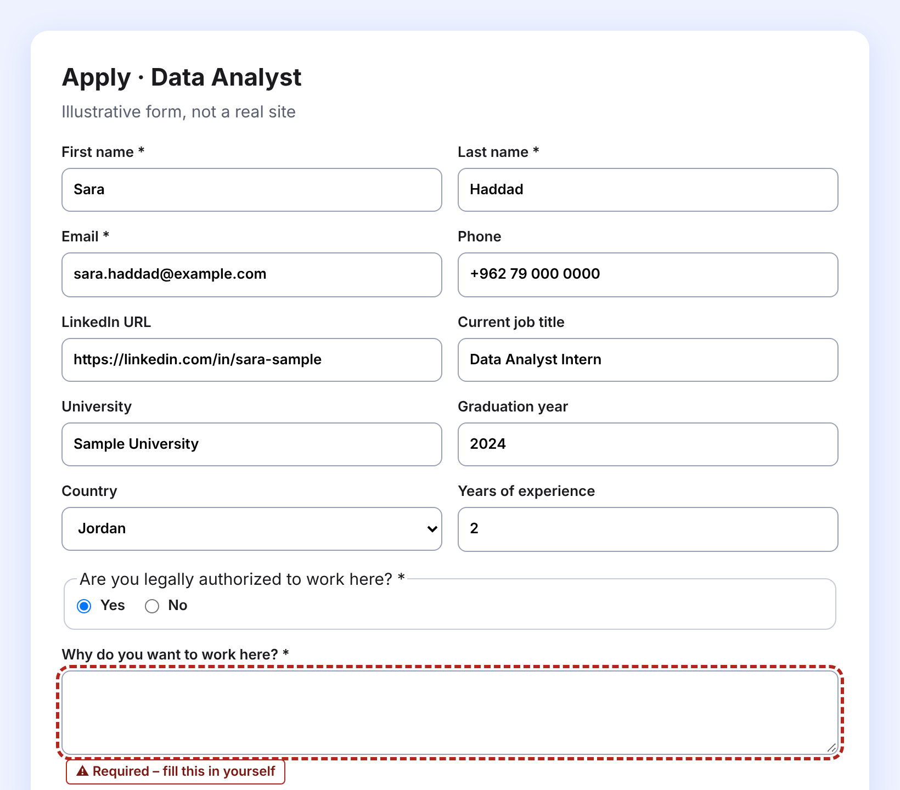
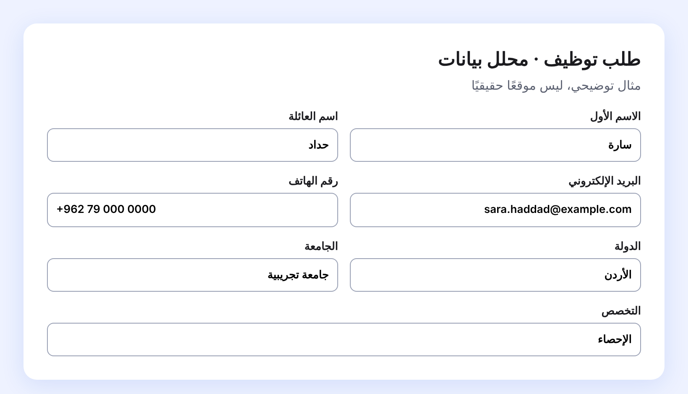
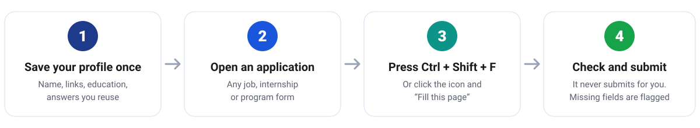
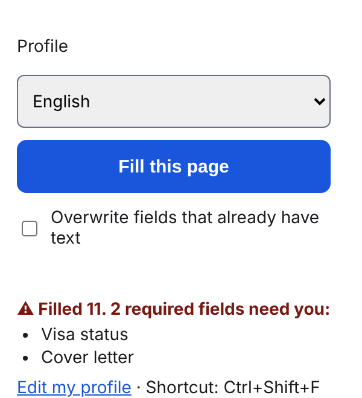
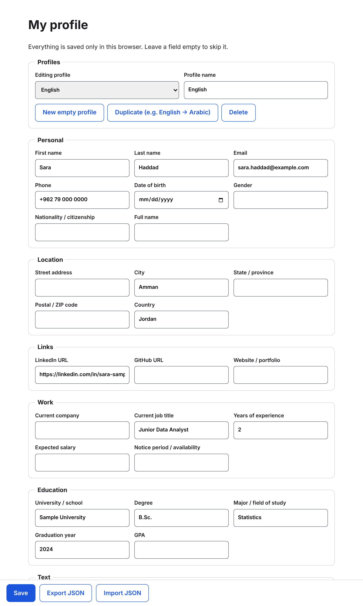
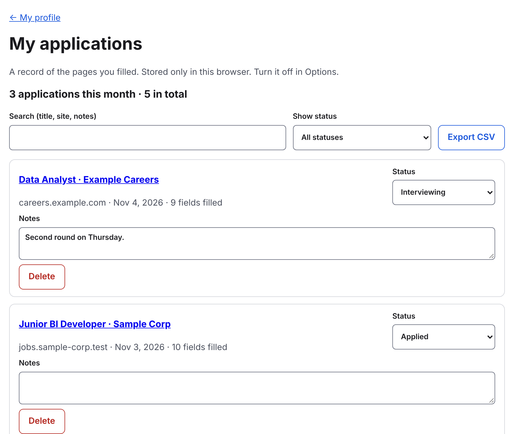

<div align="center">



<br>


**[الفكرة](#الفكرة)** · **[شاهدها تعمل](#شاهدها-تعمل)** · **[الميزات](#ماذا-تستطيع-أن-تفعل)** · **[التثبيت](#التثبيت-في-دقيقتين)** · **[الخصوصية](#الخصوصية-والأمان)** · **[أسئلة شائعة](#أسئلة-شائعة)** · **[English](README.md)**

</div>

<div dir="rtl">

<br>

## الفكرة

التقديم على الوظائف والتدريب والبرامج يعني أن تكتب اسمك وبريدك وهاتفك وجامعتك ورابط LinkedIn في نموذج بعد نموذج. الأسئلة تكاد لا تتغير. أنت من تتعب.

**One-Click Form Filler** يحفظ بياناتك في ملف شخصي لا يتحكم به غيرك، ويملأ النموذج الذي أمامك بضغطة واحدة أو باختصار من لوحة المفاتيح. تراجع ما كُتب ثم تضغط إرسال بنفسك. هو **لا يرسل شيئًا نيابةً عنك أبدًا.**

صُمّم لمن يقدّم بأكثر من لغة، فيفهم النماذج العربية والإنجليزية، ويمكنك الاحتفاظ بملف شخصي لكل لغة.

<br>

## شاهدها تعمل

</div>

<table>
<tr>
<td width="50%" align="center"><b>قبل</b><br><sub>نموذج رأيته مئة مرة</sub><br><br></td>
<td width="50%" align="center"><b>بعد ضغطة واحدة</b><br><sub>تعبئة من ملفك، والسؤال الوحيد الذي لم تعرفه مُعلَّم</sub><br><br></td>
</tr>
</table>

<div dir="rtl">

> النماذج في الصور صفحات تجريبية مصطنعة، والشخص في الملف الشخصي وهمي (`Sara Haddad`). لا توجد بيانات حقيقية ولا مواقع حقيقية في لقطات الشاشة.

وتقرأ النماذج العربية كذلك، وتملؤها بالاتجاه الصحيح:

</div>

<p align="center"></p>

<div dir="rtl">

<br>

## كيف تعمل

</div>



<div dir="rtl">

في الخلفية تنظر الإضافة إلى اسم كل حقل (label) والـ name والـ placeholder وتلميح `autocomplete`، فتعرف ما المطلوب ("الاسم الأول"، "سنة التخرج"، "هل لديك تصريح عمل؟")، ثم تكتب الإجابة بالطريقة التي تتوقعها نماذج React وVue، فتلاحظ الصفحة التغيير.

<br>

## ماذا تستطيع أن تفعل

| ⚡ تعبئة سريعة | 🧠 تتعلّمك | 🗂 تنظيم |
|---|---|---|
| ضغطة واحدة أو `Ctrl+Shift+F` (`⌘⇧F` على ماك) | **علّمها**: كليك يمين على أي حقل واكتب الجواب مرة واحدة | عدة ملفات شخصية (عربي، إنجليزي، لكل هدف ملف) |
| حقول نصية، قوائم منسدلة، radio، checkbox | **قواعد مخصصة**: "إذا احتوى الحقل على X فالجواب Y" | خبرات وتعليم متعددة، تُعبّأ كتلةً كتلة |
| نماذج React وVue | **أسئلة شائعة**: تصريح العمل، الكفالة، الانتقال، فترة الإشعار، الراتب وغيرها، بالعربي والإنجليزي | رفع السيرة الذاتية في حقول الـ resume |
| حقول داخل shadow DOM والإطارات | إجابات نعم/لا تُطابَق بالمعنى، فلا يختار "لا" عبارة "لا ينطبق" | سجل خاص بما قدّمت عليه، مع الحالة والملاحظات |
| لا ترسل أبدًا، ولا تكتب فوق ما كتبته (إلا إذا طلبت) | | |

| 🔒 احمِ نفسك | 👀 ابقَ مسيطرًا | ✨ مساعدة AI اختيارية |
|---|---|---|
| قفل اختياري بعبارة مرور (AES-GCM) | تقرير بالحقول المطلوبة التي لم تُعبَّأ، بإطار وبنص تنبيه، لا باللون وحده | مطفأة افتراضيًا |
| قائمة "عبّئ في هذه المواقع فقط" | تراجع كل شيء قبل الإرسال | تكتب مسودة جواب لأسئلة مفتوحة ("لماذا تريد العمل لدينا؟") من أجزاء الملف التي *تسمح بها أنت* |
| تذكير بالنسخ الاحتياطي، ونسخ مشفّرة | | تعدّلها ثم تضغط إدراج. لا تُدرَج وحدها |

<br>

## لقطات الشاشة

</div>

<table>
<tr>
<td width="26%" valign="top" align="center"><b>النافذة المنبثقة</b><br><sub>اختر ملفًا، عبّئ، واعرف ما الناقص</sub><br><br></td>
<td width="74%" valign="top" align="center"><b>ملفك الشخصي</b><br><sub>كل شيء يبقى في هذا المتصفح فقط</sub><br><br></td>
</tr>
<tr>
<td colspan="2" align="center"><br><b>طلباتي</b><br><sub>ابحث، حدّد الحالة، أضف ملاحظات، صدّر CSV</sub><br><br></td>
</tr>
</table>

<div dir="rtl">

<br>

## التثبيت في دقيقتين

بلا متجر ولا حساب ولا بناء. تحمّلها مباشرة من هذا المجلد.

</div>

```bash
git clone https://github.com/Ayaalmadhon2004/Autofill-extension.git
```

<div dir="rtl">

1. في Chrome افتح `chrome://extensions` وفعّل **وضع المطوّر** (Developer mode) أعلى الصفحة.
2. اضغط **Load unpacked** (تحميل إضافة غير مضغوطة) واختر المجلد الذي نزّلته، وهو الذي يحتوي `manifest.json`.
3. ثبّت الإضافة من قائمة القطعة (puzzle) لتبقى أيقونتها على بعد ضغطة.
4. تفتح صفحة ترحيب عند أول تثبيت. أضف بياناتك، أو افتح **Edit my profile** في أي وقت.

**للاستخدام:** افتح نموذج تقديم، ثم اضغط الأيقونة ← **Fill this page**، أو اضغط `Ctrl+Shift+F`.

**للتحديث لاحقًا:**

</div>

```bash
git pull
```

<div dir="rtl">

ثم اضغط زر إعادة التحميل ↻ على بطاقة الإضافة في `chrome://extensions`.

> **أبقِ المجلد في مكانه.** يقرأ Chrome الإضافة من هذا الموضع، فنقله أو حذفه يزيل الإضافة. بياناتك يخزّنها المتصفح، لا المجلد.

متصفحات Chromium الأخرى (Edge وBrave) تعمل بالخطوات نفسها لكنها لم تُجرَّب.

<br>

## الخصوصية والأمان

بياناتك لا تغادر متصفحك. لا خادم ولا حساب ولا تحليلات.

| | |
|---|---|
| **أين تُخزَّن بياناتك** | في `chrome.storage.local` داخل ملف متصفحك الشخصي |
| **ماذا تقرأ** | لا شيء حتى تضغط تعبئة (أو الاختصار) في ذلك التبويب. الصلاحيات هي فقط `activeTab` و`scripting` و`storage` و`contextMenus` |
| **قفل بعبارة مرور** *(اختياري)* | تُشفَّر الملفات الشخصية أثناء التخزين: AES-GCM، ومفتاح مشتق من عبارتك بـ PBKDF2-SHA256 (600,000 جولة). يبقى المفتاح المفتوح في تخزين الجلسة ويختفي عند إغلاق المتصفح. **لا يوجد استرجاع إذا نسيتها** |
| **ما لا يغطيه القفل** | السيرة الذاتية المرفوعة وسجل الطلبات مخزَّنان دون تشفير في هذا المتصفح |
| **قائمة المواقع المسموحة** *(اختياري)* | تعبئة في المواقع التي تذكرها فقط، مثل `careers.example.com` أو `*.example.com` |
| **النسخ الاحتياطي** | تذكير كل 14 يومًا افتراضيًا، والملف مشفّر إن وضعت عبارة مرور، وتخبرك الشاشة إن لم يكن كذلك |
| **الاستثناء الوحيد الاختياري** | **اقتراحات الذكاء الاصطناعي.** مطفأة حتى تفعّلها وتوافق وتضع مفتاح Anthropic API *الخاص بك*. لا يُرسَل شيء إلا حين تطلب مسودة: نص السؤال، ومسمى الوظيفة والشركة من الصفحة، و*أجزاء الملف التي حدّدتها فقط* إلى `api.anthropic.com`. لا يُرسَل بريدك ولا هاتفك ولا عنوانك ولا سيرتك الذاتية أبدًا. الاستخدام يُحاسَب على حسابك أنت، بحد أقصى 30 مسودة لكل جلسة متصفح |

<br>

## حدود يجب أن تعرفها

هذه نسخة مبكرة (`0.1.0`). من الأفضل أن تعرف الآتي قبل الاعتماد عليها:

- **جُرِّبت على نماذج مصطنعة لا على مواقع توظيف حقيقية.** الكود يتعامل مع التقنيات التي تستخدمها صفحات على طراز Workday وGreenhouse وLever، لكن راجع ما عُبّئ، خاصة في موقع جديد عليك. إن أخطأ موقع، أضف قاعدة مخصصة أو افتح issue.
- **بعض الصفحات لا يمكن الوصول إليها.** الـ shadow roots المغلقة، والإطارات من مواقع أخرى التي لا يسمح Chrome بالوصول إليها، تُتخطّى.
- **رفع السيرة الذاتية يعمل على حقول file الظاهرة فقط.** كثير من المواقع تخفي الحقل خلف زر منسّق، وهذه تُتخطّى حاليًا.
- **Chrome لسطح المكتب فقط.** Chrome على أندرويد لا يشغّل إضافات كهذه.
- **لا تجيب عن كل شيء.** الأسئلة النصية الحرة تُترك لك (أو لمسودة الذكاء الاصطناعي الاختيارية). تفضّل ترك الحقل فارغًا على التخمين.

<br>

## أسئلة شائعة

<details>
<summary><b>هل قد ترسل طلبي بالخطأ؟</b></summary>

لا. هي تملأ الحقول فقط. لا يوجد فيها كود يضغط زر الإرسال، ولا تضغط Enter داخل نموذج.
</details>

<details>
<summary><b>ماذا لو كتبتُ شيئًا في حقل مسبقًا؟</b></summary>

تتركه كما هو. فعّل *Overwrite fields that already have text* في النافذة إن أردت استبداله.
</details>

<details>
<summary><b>هل تعمل على نموذج عربي؟</b></summary>

نعم. تتعرف على تسميات مثل الاسم الأول والبريد الإلكتروني والجامعة. احتفظ بملف عربي وآخر إنجليزي وبدّل بينهما من النافذة.
</details>

<details>
<summary><b>كيف أنقل بياناتي إلى جهاز آخر؟</b></summary>

من **Options** استخدم **Export JSON** لملف واحد، أو زر النسخ الاحتياطي لكل الملفات، ثم **Import** على الجهاز الآخر. تُضاف المستوردات بجانب ما عندك دون استبدال شيء.
</details>

<details>
<summary><b>عبّأت شيئًا خاطئًا في حقل. ماذا أفعل؟</b></summary>

كليك يمين على الحقل ← **Teach Form Filler this field…** واكتب الجواب الصحيح. ستُجاب المرة القادمة بشكل صحيح. القاعدة التي تطابق الحقل تتغلب دائمًا على التخمينات المدمجة.
</details>

<details>
<summary><b>هل أحتاج ميزة الذكاء الاصطناعي؟</b></summary>

لا. كل شيء آخر يعمل بدونها، وتبقى مطفأة تمامًا ما لم تفعّلها.
</details>

<br>

## للمطوّرين

بلا خطوة بناء: JavaScript عادي يحمّله Chrome كما هو.

| الملف | وظيفته |
|---|---|
| `fields.js` | القائمة الوحيدة لحقول الملف الشخصي وكيفية التعرف على كل حقل، بالعربي والإنجليزي |
| `filler.js` و`signature.js` و`groups.js` و`questions.js` | محرك التعبئة: المطابقة، shadow DOM، الكتل المتكررة، الأسئلة الشائعة |
| `runner.js` و`security.js` و`background.js` | تحميل الحالة، حقن المعبّئ، قفل العبارة، قائمة المواقع، الاختصار |
| `popup.*` و`options.*` و`history.*` و`onboarding.*` | الصفحات التي تراها |
| `teach.js` و`ai.js` و`ai-suggest.js` | التعليم بالكليك اليمين ومسودات الذكاء الاصطناعي الاختيارية |
| `tests/` | اختبارات Playwright وNode (بلا شبكة، وواجهة Anthropic مُحاكاة) |

لتشغيل كل الاختبارات (تحتاج Node وPlaywright عامًا مع Chromium):

</div>

```bash
for t in tests/*.test.js tests/security.filler.pw.js tests/security.ui.pw.js; do NODE_PATH=$(npm root -g) node "$t" || echo "FAILED: $t"; done
```

<div dir="rtl">

حقل جديد؟ أضف سطرًا في `fields.js`. سؤال جديد؟ أضفه في `questions.js`. كلاهما بيانات لا منطق.

<br>

<div align="center">

صُنعت لكل من تعب من كتابة اسمه.

</div>

</div>
