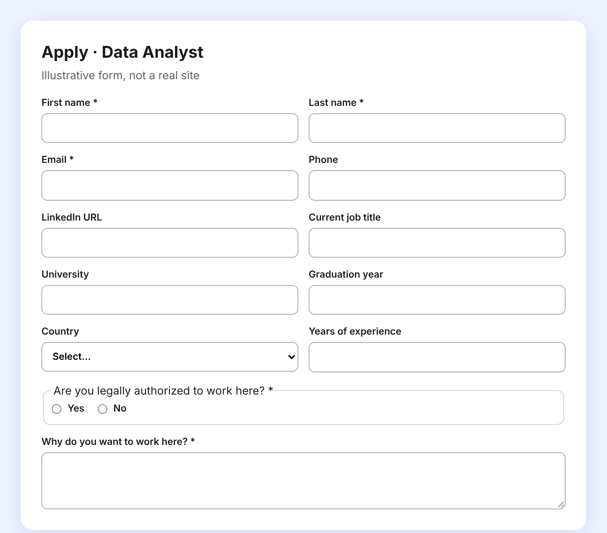
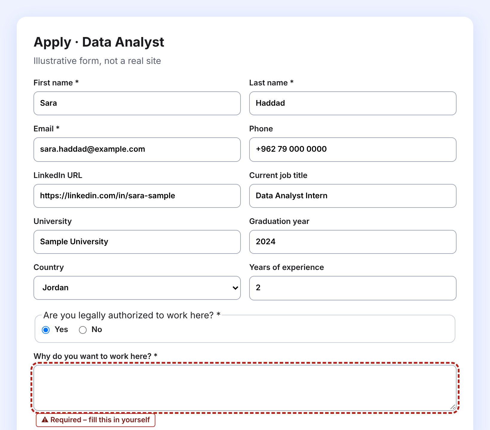
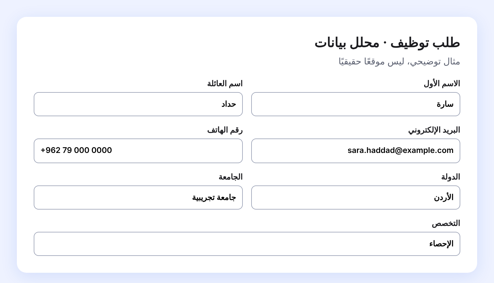
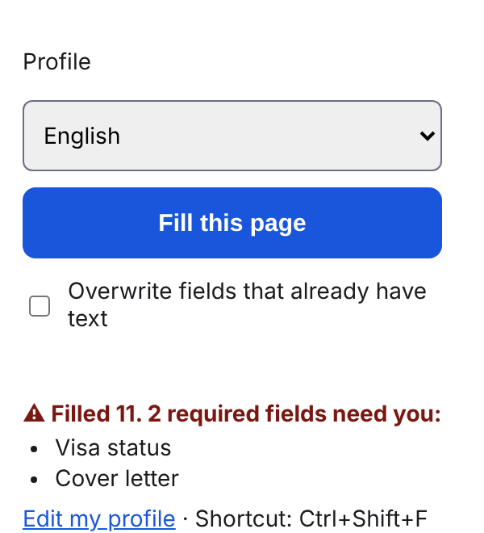
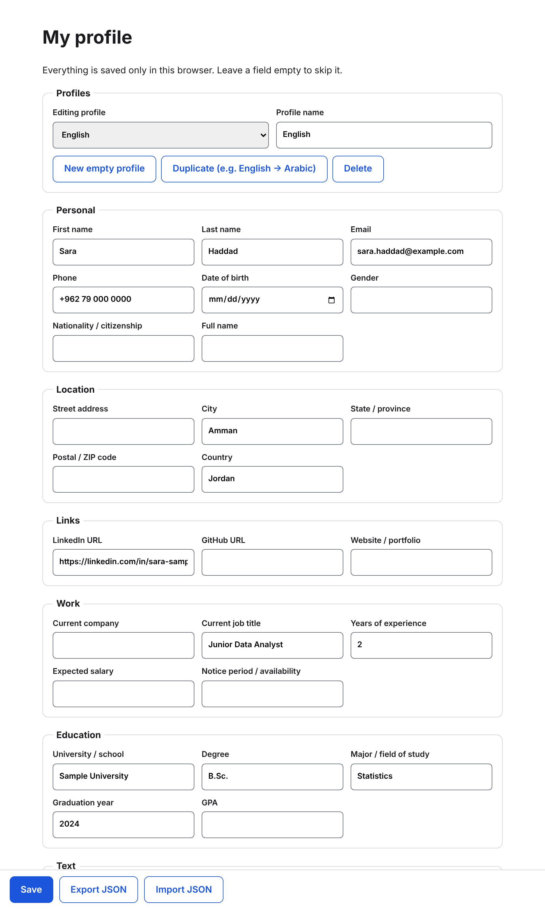
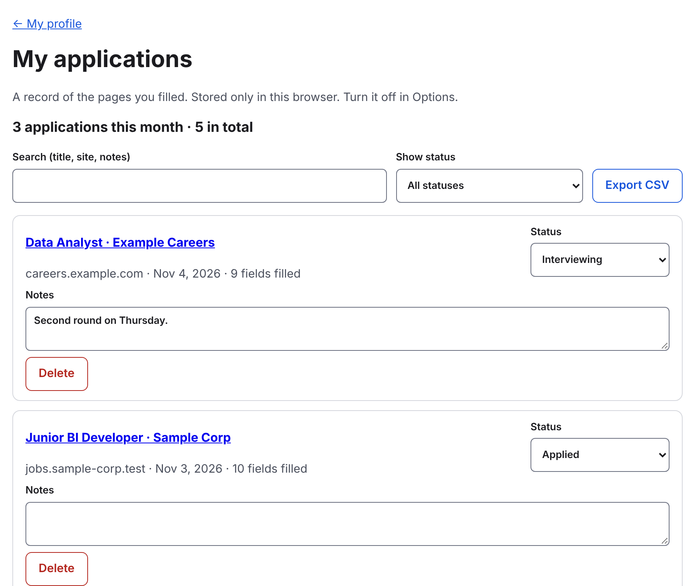

<div align="center">



<br>


**[The idea](#the-idea)** · **[See it work](#see-it-work)** · **[Features](#what-it-can-do)** · **[Install](#install-in-two-minutes)** · **[Privacy](#privacy-and-security)** · **[FAQ](#questions-you-might-have)** · **[عربي](README.ar.md)**

</div>

<br>

## The idea

Applying for jobs, internships and programs means typing your name, email, phone, university and LinkedIn link into one form after another. The questions barely change. You do.

**One-Click Form Filler** keeps your details in a profile that only you control, and fills the form in front of you with one click or one shortcut. You read it over and press submit yourself. It never submits anything for you.

It was built for people who apply in more than one language, so it understands English *and* Arabic forms, and you can keep a separate profile for each.

<br>

## See it work

<table>
<tr>
<td width="50%" align="center"><b>Before</b><br><sub>A form you have seen a hundred times</sub><br><br></td>
<td width="50%" align="center"><b>After one click</b><br><sub>Filled from your profile; the one question it could not answer is flagged</sub><br><br></td>
</tr>
</table>

> The forms above are made-up demo pages and the profile is a made-up person (`Sara Haddad`). No real data or real site appears anywhere in this repository's screenshots.

It reads Arabic forms just as well, and fills them in the right direction:

<p align="center"></p>

<br>

## How it works


Behind the scenes it looks at each field's label, name, placeholder and `autocomplete` hint, works out what is being asked ("first name", "graduation year", "are you authorized to work?"), and types the answer the way React and Vue forms expect, so the page notices the change.

<br>

## What it can do

<table>
<tr>
<td width="33%" valign="top">

### ⚡ Fill fast
- One click or `Ctrl+Shift+F` (`⌘⇧F` on Mac)
- Text boxes, dropdowns, radio buttons, checkboxes
- Forms built with React or Vue
- Fields inside shadow DOM and frames
- Never submits, never overwrites what you typed (unless you ask)
- The whole interface comes in **English and Arabic** (right-to-left), switchable in the popup

</td>
<td width="33%" valign="top">

### 🧠 Learn you
- **Teach it**: right-click any field, type the answer once
- **Custom rules**: "label contains X → answer Y"
- **Common questions**: work authorization, sponsorship, relocation, notice period, salary and more, in English and Arabic
- Yes/No answers match by meaning, so "No" never picks "Not applicable"

</td>
<td width="33%" valign="top">

### 🗂 Stay organised
- Several profiles (English, Arabic, one per goal)
- Work experience and education entries, filled block by block
- Attaches your CV to resume upload fields
- A private log of what you applied to, with status and notes

</td>
</tr>
<tr>
<td valign="top">

### 🔒 Protect yourself
- Optional passphrase lock (AES-GCM)
- "Only fill on these sites" allowlist
- Reminders to back up, with encrypted backups

</td>
<td valign="top">

### 👀 Stay in control
- A report of required fields it could not fill, outlined with a text marker, never colour alone
- You review everything before you submit

</td>
<td valign="top">

### ✨ Optional AI help
- Off by default
- Drafts an answer to open questions ("Why do you want to work here?") from the profile parts *you* allow
- You edit it, then click Insert. It is never inserted on its own

</td>
</tr>
</table>

<br>

## Screenshots

<table>
<tr>
<td width="26%" valign="top" align="center"><b>Popup</b><br><sub>Pick a profile, fill, see what is missing</sub><br><br></td>
<td width="74%" valign="top" align="center"><b>Your profile</b><br><sub>Everything lives in this browser only</sub><br><br></td>
</tr>
<tr>
<td colspan="2" align="center"><br><b>My applications</b><br><sub>Search, set a status, add notes, export CSV</sub><br><br></td>
</tr>
</table>

<br>

## Install in two minutes

No store, no account, no build. You load it straight from this folder.

```bash
git clone https://github.com/Ayaalmadhon2004/Autofill-extension.git
```

1. In Chrome, open `chrome://extensions` and switch on **Developer mode** (top right).
2. Click **Load unpacked** and choose the folder you just cloned (the one with `manifest.json` in it).
3. Pin the extension from the puzzle-piece menu so the icon is always one click away.
4. A welcome page opens on first install. Add your details, or open **Edit my profile** any time.

**Use it:** open an application form, then click the icon → **Fill this page**, or press `Ctrl+Shift+F`.

**Update it later:**

```bash
git pull
```

then press the reload ↻ button on the extension's card in `chrome://extensions`.

> **Keep the folder where it is.** Chrome reads the extension from that location, so moving or deleting it removes the extension. Your data is stored by the browser, not in the folder.

Other Chromium browsers (Edge, Brave) use the same steps but have not been tried.

<br>

## Privacy and security

Your details never leave your browser. There is no server, no account, no analytics.

| | |
|---|---|
| **Where your data lives** | `chrome.storage.local`, inside your own browser profile |
| **What it reads** | Nothing, until you click Fill (or use the shortcut) on that tab. Permissions are only `activeTab`, `scripting`, `storage` and `contextMenus` |
| **Passphrase lock** *(optional)* | Profiles are encrypted at rest: AES-GCM, key from your passphrase via PBKDF2-SHA256 (600,000 rounds). The unlocked key lives only in session storage and disappears when the browser closes. **There is no recovery if you forget it** |
| **Not covered by the lock** | The uploaded CV and the applications history are stored unencrypted in this browser |
| **Site allowlist** *(optional)* | Fill only on hostnames you list, such as `careers.example.com` or `*.example.com` |
| **Backups** | A reminder every 14 days by default; the backup file is encrypted if you set a passphrase, and the screen tells you when it is not |
| **The one optional exception** | **AI suggestions.** Off until you enable it, tick consent and paste *your own* Anthropic API key. Only when you ask for a draft does it send the question, the page's job title and company, and *only the profile parts you ticked* to `api.anthropic.com`, never your email, phone, address or CV. Usage is billed to your own account. Capped at 30 drafts per browser session |

<br>

## Honest limits

This is an early version (`0.1.0`). Worth knowing before you rely on it:

- **Tested on made-up forms, not on real job sites.** The code handles the techniques Workday-, Greenhouse- and Lever-style pages use, but check what it filled, especially on a site you have not used before. If a site misbehaves, add a custom rule or open an issue.
- **Some pages can't be reached.** Closed shadow roots, and frames from other sites that Chrome does not allow access to, are skipped.
- **CV upload only works on visible file inputs.** Many sites hide the input behind a styled button; those are skipped for now.
- **Desktop Chrome only.** Chrome on Android does not run extensions like this.
- **It does not answer everything.** Free-text questions are left for you (or for the optional AI draft). It would rather leave a field empty than guess.

<br>

## Questions you might have

<details>
<summary><b>Will it submit my application by accident?</b></summary>

No. It only fills fields. It has no code that clicks submit, and it never presses Enter in a form.
</details>

<details>
<summary><b>What if I already typed something in a field?</b></summary>

It leaves it alone. Tick *Overwrite fields that already have text* in the popup if you want it to replace them.
</details>

<details>
<summary><b>Can I use it on a form in Arabic?</b></summary>

Yes. Arabic labels such as الاسم الأول, البريد الإلكتروني and الجامعة are recognised. Keep an English and an Arabic profile and switch between them in the popup.
</details>

<details>
<summary><b>How do I move my data to another computer?</b></summary>

In **Options**, use **Export JSON** for one profile, or the backup button for all of them, then **Import** on the other computer. Imports are added next to what you already have; nothing is overwritten.
</details>

<details>
<summary><b>It filled the wrong thing in a field. What now?</b></summary>

Right-click that field → **Teach Form Filler this field…** and type the right answer. The same question will be answered correctly next time. A rule that matches a label always wins over the built-in guesses.
</details>

<details>
<summary><b>Do I need the AI feature?</b></summary>

No. Everything else works without it, and it stays completely off unless you turn it on.
</details>

<br>

## For developers

No build step: plain JavaScript, loaded as-is by Chrome.

| File | What it does |
|---|---|
| `fields.js` | The single list of profile fields and how each one is recognised, English and Arabic |
| `filler.js`, `signature.js`, `groups.js`, `questions.js` | The filling engine: matching, shadow DOM, repeated blocks, common questions |
| `runner.js`, `security.js`, `background.js` | Loads state, injects the filler, passphrase lock, allowlist, keyboard shortcut |
| `popup.*`, `options.*`, `history.*`, `onboarding.*` | The pages you see |
| `teach.js`, `ai.js`, `ai-suggest.js` | Right-click teaching and the optional AI drafts |
| `i18n.js` | Every interface string in English and Arabic, plus language switching |
| `tests/` | Playwright and Node tests (no network; the Anthropic API is mocked) |

Run the whole suite (needs Node and a global Playwright with Chromium):

```bash
for t in tests/*.test.js tests/*.pw.js; do NODE_PATH=$(npm root -g) node "$t" || echo "FAILED: $t"; done
```

A new field? Add one line to `fields.js`. A new question? Add it to `questions.js`. A new interface language? Copy the `en` block in `i18n.js`, translate the values, register it, and run `node tests/i18n.core.test.js` (it checks that no key or placeholder is missing). All three are data, not logic.

<br>

<div align="center">

Made for anyone who is tired of typing their own name.

Released under the [MIT License](LICENSE).

</div>
